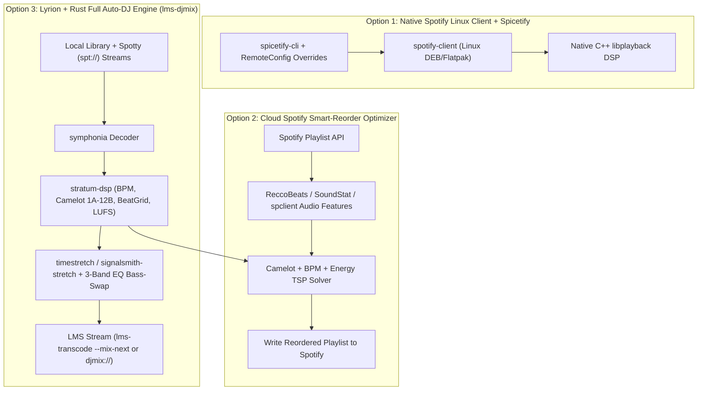

# Spotify Playlist "Mix" & Lyrion Rust DJ Automation — Deep Research Synthesis

## 1. Executive Summary (BLUF)
Spotify's **"Mix"** feature (launched Aug 2025) and **"Smart Reorder"** (launched Feb 2026) sequence user playlists by **Camelot musical key (`1A`–`12B`)** and **BPM**, and execute real-time beat-matched time-stretching, cue-point slicing, and 3-band EQ bass-swaps inside Spotify's proprietary native C++ `libplayback` engine. Because `open.spotify.com` runs in browser HTML5 `<audio>`/EME without `libplayback`, clicking **Mix** in the web player triggers the *"Enjoy mixed playlists with the Linux app"* gate, and casting over **Spotify Connect / `librespot` / `Spotty`** strips all custom DJ transitions (`librespot` Issue #1592).

You have **four concrete ways** to access or recreate this capability—ranging from unlocking Spotify's native feature on this Linux machine in 5 minutes to building an open, self-hosted **Pure-Rust DJ Mix Engine** that works across Spotify playlists, Lyrion Music Server (`slimserver`), and local libraries.

---

## 2. How Spotify's "Mix" Feature Actually Works Under the Hood

### A. Feature Mechanics (`Mix` + `Smart Reorder`)
1. **Harmonic & Tempo Sequencing (`Smart Reorder`)**: Evaluates each track's **BPM** and **Camelot key** (`1A`–`12B`) to reorder playlists so adjacent tracks sit within compatible harmonic steps and minimal tempo deltas.
2. **Dual-Deck Beatgrid & Waveform Alignment**: Aligns the outgoing track's outro bars with the incoming track's intro bars along quantized beat/bar markers.
3. **Real-Time Time-Stretching & EQ Bass-Swap**: Dynamically time-stretches the outgoing/incoming tracks in `libplayback` without pitch-shifting, while applying preset or custom volume envelopes (*Fade*, *Rise*, *Blend*, *Wave*) and 3-band EQ low-end swaps so kick drums do not collide.

### B. Internal Protocol (`spclient`) & API Landscape
- **Playlist Storage (`playlist/v2`)**: Synchronized via binary Protocol Buffers over `https://spclient.wg.spotify.com/playlist/v2/playlist/{id}`. Playlist-level `FormatListAttributes` flag the playlist as mixed; per-track `ItemAttributes` store custom `cue-in`/`cue-out` offsets, transition preset IDs, and envelope/EQ parameters.
- **Beatgrid & Key Metadata (`audio-attributes/v1`)**: Desktop/mobile clients fetch BPM, Camelot key, and beat/bar/segment grids from internal Webgate endpoints:
  - `wg://audio-attributes/v1/audio-features/{track_id}`
  - `wg://audio-attributes/v1/audio-analysis/{track_id}`
- **Nov 27, 2024 Public Web API Deprecation**: Spotify blocked third-party Web API access (`HTTP 403`) to `/v1/audio-features` and `/v1/audio-analysis`. Viable replacements for external playlist tools are:
  1. **Local Rust DSP extraction (`stratum-dsp`)** on decoded audio or `spotty` streams.
  2. **ReccoBeats API (`api.reccobeats.com/v1/audio-features`)** & **SoundStat API (`soundstat.info`)** — drop-in public REST APIs accepting Spotify Track IDs and returning BPM, key, mode, and energy.
  3. **Internal `spclient` / `Spicetify.CosmosAsync` queries** using first-party client tokens.

---

## 3. Why Standard Lyrion (`slimserver`) & `librespot` Cannot Play Mixed Transitions Today

1. **`librespot` & `Spotty` Single-Deck Architecture**:
   - Spotify's CDN serves raw individual encrypted Ogg Vorbis / FLAC tracks; transitions are **not** pre-rendered server-side.
   - `librespot` ([Issue #1592](https://github.com/librespot-org/librespot/issues/1592)) and LMS's `Spotty` (`spotty --single-track`) decode one track at a time and ignore `ItemAttributes` transition envelopes.
2. **LMS Player-Side Crossfade Limits ([`Slim/Player/Squeezebox2.pm`](file:///home/console-admin/Github/slimserver/Slim/Player/Squeezebox2.pm#L43-L87), [`Slim/Player/Squeezebox.pm`](file:///home/console-admin/Github/slimserver/Slim/Player/Squeezebox.pm#L930-L1056))**:
   - LMS sends a 24-byte `strm` header instructing the player (`squeezelite` / Squeezebox hardware) to overlap the last `transitionDuration` seconds (max 10s) of PCM in the output ring buffer.
   - The player has **no beatgrid awareness**, **no time-stretcher** (`maxPitch = 100`), **no 3-band EQ bass swap**, and aborts crossfading whenever adjacent tracks have different sample rates (`transitionSampleRestriction`).

---

## 4. Technical Comparison of Rust & Open-Source DJ Building Blocks

### A. Track Analysis (BPM, Beatgrid, Camelot Key `1A`–`12B`, Cue Points)
| Crate / Library | Type | BPM & Beatgrid | Camelot Key (`1A`–`12B`) | Loudness / Cue Points | Verdict |
| :--- | :--- | :--- | :--- | :--- | :--- |
| **[`stratum-dsp`](https://crates.io/crates/stratum-dsp)** | **100% Pure Rust** | FFT + Autocorrelation Tempogram + **HMM Beat Tracker** (`beat_grid`) | **Native Camelot (`1A`–`12B`)**, Open Key & Standard via HPCP chroma | ITU-R BS.1770-4 **LUFS** + silence trimming | **Primary Choice** (zero C/FFI deps, pairs with `symphonia`) |
| **[`timestretch`](https://crates.io/crates/timestretch)** | **100% Pure Rust** | EDM BeatGrid + downbeat estimation (`BeatGrid::snap_to_beat`) | Pitch-lock awareness | Beat-snapped slicing | **Primary Companion** for beat-snapping + time-stretching |
| **[`bliss-rs`](https://github.com/Polochon-street/bliss-rs)** | Rust + C (`aubio`) | Global BPM only (no beatgrid) | 13-D chroma distance vector (no Camelot label) | Global loudness only | Used in `BlissMixer` for radio similarity; insufficient for DJ beatmatching |

### B. Time-Stretching & Beat-Matched Transition DSP
| Crate / Engine | Type | Algorithm | Tempo Ramping | Audio Quality | Verdict |
| :--- | :--- | :--- | :--- | :--- | :--- |
| **[`timestretch`](https://github.com/robmorgan/timestretch-rs)** | **100% Pure Rust (MIT)** | Two-band time-domain SOLA + transient protection | **Yes** (`stretch_to_bpm` real-time ratio) | Preserves punchy drum transients on beat-matched transitions | **Best Pure-Rust DJ Time-Stretcher** |
| **[`signalsmith-stretch`](https://crates.io/crates/signalsmith-stretch)** | Rust + header-only C++11 (MIT) | Spectral Phase Vocoder with vertical phase coherence | **Yes** (per-block ratio & transpose) | Studio-grade vocal/polyphonic smoothness up to $\pm 15\%$ | **Best for wide BPM gaps (>5%)** |
| **[`rubato`](https://crates.io/crates/rubato)** | **100% Pure Rust (MIT)** (Already in [`rust/Cargo.toml`](file:///home/console-admin/Github/slimserver/rust/Cargo.toml#L20)) | Polynomial/Sinc resampler (`FastFixedIn`) | **Yes** (`set_resample_ratio_relative`, varispeed) | Zero vocoder phase smearing | Ideal for micro-sync ($<1.8\%$ BPM delta) + sample rate unification |

---

## 5. Architectural Options Breakdown

### Option 1: Unlock Spotify's Official "Mix" Directly on Linux (`spotify-client` + `Spicetify`)
- **What it does**: Installs the official Linux `spotify-client` (not currently installed on this host, which is why the browser showed that popup) plus `spicetify-cli`. Configures `RemoteConfigResolver` experimental flags (`mix`, `automix`, `smart_reorder`) and `spicetify-glide` so you get Spotify's native C++ `libplayback` Mix UI, waveform cue editor, and Smart Reorder directly on your desktop.
- **Pros**: Zero custom DSP code needed; immediate access to Spotify's official Mix feature and beatgrids.
- **Cons**: Only plays through the local Spotify desktop app (transitions disable when casting over Spotify Connect to Lyrion/Squeezelite).

### Option 2: Automated "Smart Reorder" Playlist Optimizer for Spotify & LMS (Harmonic + BPM TSP Solver)
- **What it does**: A standalone Rust CLI / daemon (and LMS plugin command) that takes any Spotify playlist URL or LMS playlist, fetches or computes **BPM + Camelot Key (`1A`–`12B`) + Energy** (via ReccoBeats/SoundStat API or `stratum-dsp`), solves the **Minimum-Cost Hamiltonian Path (Traveling Salesperson Problem)** using Camelot wheel harmonic rules + octave-folded BPM distance, and saves the optimally sequenced playlist directly back to your Spotify account (or reorders your active LMS queue).
- **Pros**: Works on *any* device (even web player, mobile, car, or Spotify Connect) because the playlist order itself is permanently optimized in Spotify; can be combined with standard Automix/crossfade.
- **Cons**: Reorders tracks like a real DJ setlist, but relies on the playback client for the audio transition itself.

### Option 3: Full Pure-Rust Beat-Matched DJ Transition Engine in Lyrion (`lms-djmix` + `lms-transcode`)
- **What it does**: Extends our new 7-crate Rust workspace in [`/home/console-admin/Github/slimserver/rust/`](file:///home/console-admin/Github/slimserver/rust/Cargo.toml) with an 8th crate (`lms-djmix`) powered by `stratum-dsp` + `timestretch`:
  1. **Analyzes** local tracks and `Spotty` (`spt://`) Spotify tracks for exact **BPM, Camelot Key (`1A`–`12B`), HMM Beatgrid, LUFS, and 8/16-bar phrase intro/outro cue points**, caching them in SQLite (`lms-cache`).
  2. **Reorders** the queue harmonically via the Camelot+BPM TSP solver.
  3. **Beat-Matches & Time-Stretches Transitions**: Using **Track-Tail Transition Folding** (`lms-transcode --mix-next <TrackB>`) + LMS's native `#start-end` URL time-slicing ([`TranscodingHelper.pm#L542`](file:///home/console-admin/Github/slimserver/Slim/Player/TranscodingHelper.pm#L542)), it aligns Track A's outro downbeats with Track B's intro downbeats, smoothly ramps tempo from $\text{BPM}_A \to \text{BPM}_B$ across 8–16 bars without changing pitch, performs a **3-band Linkwitz-Riley EQ bass swap** at 250 Hz, and streams gapless FLAC/PCM to **any Squeezebox / Squeezelite player** (including your production server `10.0.0.10`).
- **Pros**: Recreates the full real-DJ experience (harmonic ordering + tempo-ramped beatmatching + EQ bass swap) on Lyrion Music Server for both local FLAC/MP3s and Spotify (`Spotty`) tracks, while preserving per-track UI progress and skipping.

### Option 4: Reverse-Engineer / Bridge Spotify's Internal `spclient` Mix Attributes
- **What it does**: Uses an authenticated `librespot` / `spclient` session to query Spotify's internal `wg://audio-attributes/v1/audio-analysis/{id}` and `playlist/v2` `ItemAttributes` (reading Spotify's own precomputed beatgrids, Camelot keys, and custom `cue-in`/`cue-out` transition markers from playlists you mixed in the Spotify app) and feeds those exact cue points into our Rust transition renderer.
- **Pros**: Reuses Spotify's Echo Nest beatgrids and your saved Spotify Mix cue points without re-analyzing audio.

---

## 6. Sources & References
- [Spotify Newsroom — Mix Your Favorite Playlists Seamlessly (Aug 19, 2025)](https://newsroom.spotify.com/2025-08-19/mix-your-favorite-playlists-seamlessly-by-adding-your-own-transitions/)
- [Spotify Newsroom — Level Up Your Playlists' Transitions With Smart Reorder (Feb 25, 2026)](https://newsroom.spotify.com/2026-02-25/smart-reorder-mixed-playlists/)
- [Spotify Developer Blog — Changes to the Web API (Nov 27, 2024)](https://developer.spotify.com/blog/2024-11-27-changes-to-the-web-api)
- [librespot Issue #1592 — Spotify 'Mix' feature integration](https://github.com/librespot-org/librespot/issues/1592)
- [`stratum-dsp` Crate (Pure-Rust BPM, Beatgrid, Camelot Key & LUFS)](https://crates.io/crates/stratum-dsp)
- [`timestretch` Crate (`timestretch-rs`, Pure-Rust DJ Beat-Matched Time Stretching)](https://github.com/robmorgan/timestretch-rs)
- [`signalsmith-stretch` Crate (Rust Phase Vocoder Time/Pitch Shifting)](https://crates.io/crates/signalsmith-stretch)
- [`spicetify-glide` (Spotify Desktop Crossfade/Mix Extension)](https://github.com/janakchoudharydev/spicetify-glide)
- [`pyCrossfade` (Beat-Matched BPM Ramp & 3-Band EQ Bass Swap Reference)](https://github.com/oguzhan-yilmaz/pycrossfade)
