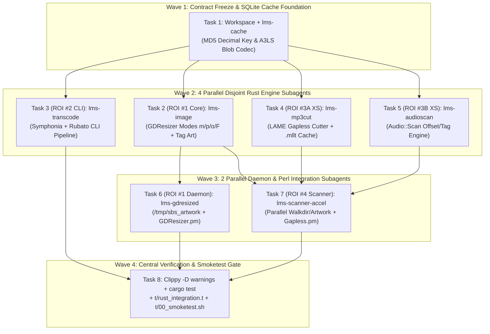

# Lyrion Music Server (`slimserver`) Incremental Rust Conversion Implementation Plan

> **For agentic workers:** REQUIRED SUB-SKILL: Use superpowers:subagent-driven-development (recommended) or superpowers:executing-plans to implement this plan task-by-task. Steps use checkbox (`- [ ]`) syntax for tracking.

**Goal:** Convert Lyrion Music Server's native C/XS and helper daemon tool stack into a unified, memory-safe Rust workspace (`/home/console-admin/Github/slimserver/rust/`) ordered strictly by ROI (Tier 1A `gdresized` UNIX socket daemon & `Image::Scale` resizer -> Tier 1B `lms-transcode` CLI pipeline helpers -> Tier 1C `MP3::Cut::Gapless` & `Audio::Scan` native media engines -> Tier 2 `lms-scanner-accel` parallel directory & artwork pre-cacher) with 100% Perl wire, SQLite, and test compatibility.

**Architecture:** Build a 7-crate Cargo workspace under `/home/console-admin/Github/slimserver/rust/` with frozen domain traits (`lms-cache`, `lms-image`, `lms-gdresized`, `lms-mp3cut`, `lms-audioscan`, `lms-transcode`, `lms-scanner-accel`) compiled into `/home/console-admin/Github/slimserver/Bin/x86_64-linux/`. Integrate into Perl via existing IPC/CLI/C-ABI boundaries (`Slim/Utils/OS.pm`, `Slim/Utils/GDResizer.pm`, `CPAN/MP3/Cut/Gapless.pm`, `Slim/Utils/Scanner/Local.pm`) gated by `LMS_USE_RUST` (default `1` when the compiled Rust binary/library exists, with automatic fallback to legacy Perl/XS).

**Tech Stack:** Rust `1.99.1` (`2021` edition), `rusqlite` (`0.32`, `bundled`), `md-5` (`0.10`), `base64` (`0.22`), `image` (`0.25`), `lofty` (`0.21`), `symphonia` (`0.5`), `rubato` (`0.15`), `walkdir` (`2.5`), `rayon` (`1.10`), `serde` / `serde_json` (`1.0`), `thiserror` (`1.0`), `anyhow` (`1.0`), `tempfile` (`3.12`); Perl `5.40.1` (`Test::More`, `IO::Socket::UNIX`).

**Spec:** [`/home/console-admin/Github/slimserver/docs/superpowers/specs/2026-10-20-lms-rust-conversion-design.md`](file:///home/console-admin/Github/slimserver/docs/superpowers/specs/2026-10-20-lms-rust-conversion-design.md)

**Execution Waves:**
- **Wave 1 (Foundation & Trait Contract Freeze — Sequential)**:
  - **Task 1**: Cargo Workspace Scaffolding & `lms-cache` (`DbCache` MD5 decimal-concatenation key + `DbArtworkCache` `pack('A3LS', ...)` binary blob codec + SQLite writer).
- **Wave 2 (Disjoint Parallel Core Crates — 4 Concurrent Subagents)**:
  - **Task 2 (ROI Tier 1A Core)**: `lms-image` (Spec parser, Bug 17140 transparency rule, `m`/`p`/`o`/`F` resizer, `resize_series`, embedded tag artwork extractor). *(Blocked by: Task 1)*
  - **Task 3 (ROI Tier 1B Core & CLI)**: `lms-transcode` (`faad`/`flac`/`wvunpack`/`sox` flag-compatible CLI decoder/resampler/encoder using `symphonia` + `rubato`). *(Blocked by: Task 1)*
  - **Task 4 (ROI Tier 1C Part 1)**: `lms-mp3cut` (Gapless MP3 LAME Xing/Info parser, `.mllt` cache generator, bit-reservoir frame cutter, CLI & `cdylib` C-ABI). *(Blocked by: Task 1)*
  - **Task 5 (ROI Tier 1C Part 2)**: `lms-audioscan` (`scan`, `scan_tags`, `scan_fh`, `find_frame_fh`, `find_frame_fh_return_info` with `AUDIO_SCAN_NO_ARTWORK` offset/length contract). *(Blocked by: Task 1)*
- **Wave 3 (Daemons, Accelerators & Perl Integration — 2 Concurrent Subagents)**:
  - **Task 6 (ROI Tier 1A Daemon & Perl Wiring)**: `lms-gdresized` (`/tmp/sbs_artwork` UNIX socket daemon + `--cli-resize`) & Perl integration in `Slim/Utils/OS.pm` and `Slim/Utils/GDResizer.pm`. *(Blocked by: Task 1, Task 2)*
  - **Task 7 (ROI Tier 1C & Tier 2 Perl Wiring + `lms-scanner-accel`)**: `lms-scanner-accel` (`scanned_files` parallel walkdir + `artwork.db` rayon pre-cacher) & Perl integration in `CPAN/MP3/Cut/Gapless.pm` and `Slim/Utils/Scanner/Local.pm`. *(Blocked by: Task 1, Task 2, Task 4, Task 5)*
- **Wave 4 (Central Verification, Clippy/Unsafe Soundness Gate & Perl End-to-End Integration Suite)**:
  - **Task 8**: Release binary deployment to `Bin/x86_64-linux/`, full-workspace `cargo clippy -- -D warnings`, `cargo test`, Perl unit tests (`t/gdresizer_explicit_format.t`, `t/rust_integration.t`, `t/verifyStrings.pl`), and live server `t/00_smoketest.sh`. *(Blocked by: Tasks 1–7)*



---

## User Review Required

> [!IMPORTANT]
> **Non-Destructive Perl Integration Strategy (`LMS_USE_RUST`)**:
> All existing Perl entrypoints (`slimserver.pl`, `scanner.pl`, `gdresized.pl`) and existing XS binaries in `CPAN/arch/5.40/` are preserved intact as immutable baselines (Rule 30). Perl integration adapters check `$ENV{LMS_USE_RUST}` (defaulting to `1` when `/home/console-admin/Github/slimserver/Bin/x86_64-linux/<rust-binary>` is present and executable) and fall back transparently to the original Perl/XS code path if disabled (`LMS_USE_RUST=0`) or on error.

> [!NOTE]
> **Disjoint Multi-Agent Concurrency Guarantee**:
> In Wave 2, Tasks 2, 3, 4, and 5 operate exclusively within their own isolated crate directories (`rust/crates/lms-image/`, `rust/crates/lms-transcode/`, `rust/crates/lms-mp3cut/`, `rust/crates/lms-audioscan/`). Workspace member registration in `/home/console-admin/Github/slimserver/rust/Cargo.toml` is frozen in Task 1 so Wave 2 agents never edit shared files concurrently.

---

## Global Constraints

- **GC-1 (Zero Unsafe Without Contract)**: Every crate must compile with `#![deny(unsafe_op_in_unsafe_fn)]` and zero warnings under `/home/console-admin/.cargo/bin/cargo clippy --all-targets -- -D warnings`. Any FFI `unsafe` block in `lms-mp3cut` or `lms-audioscan` must carry an explicit `// SAFETY:` precondition comment.
- **GC-2 (No Unwrap in Library/Daemon Code)**: Production code in `rust/crates/*/src/` must return `Result<T, E>` (`thiserror` / `anyhow`) and never panic on malformed media files or truncated socket frames.
- **GC-3 (Bit-Exact SQLite Compatibility)**: `lms-cache` must compute `k` identically to `Slim::Utils::DbCache::_key` (`format!("{}{}", u32::from_str_radix(&md5_hex[0..8], 16), u32::from_str_radix(&md5_hex[8..15], 16)).parse::<i64>()`) and pack `v` identically to `Slim::Utils::ArtworkCache` (`pack('A3LS', content_type, mtime, path_len) . path . image_bytes`).
- **GC-4 (Strict Absolute Paths & Rule 30 Baseline Preservation)**: Backups of modified Perl modules (`Slim/Utils/OS.pm`, `Slim/Utils/GDResizer.pm`, `CPAN/MP3/Cut/Gapless.pm`, `Slim/Utils/Scanner/Local.pm`) must be created under `/home/console-admin/Github/slimserver/.agents/backups/` before editing.
- **GC-5 (Existing Test Suite Invariance)**: `/usr/bin/perl -I/usr/share/perl/5.40 -I/home/console-admin/Github/slimserver/CPAN/arch/5.40/x86_64-linux-thread-multi -I/home/console-admin/Github/slimserver/CPAN/arch/5.40 -I/home/console-admin/Github/slimserver/CPAN -I/home/console-admin/Github/slimserver /home/console-admin/Github/slimserver/t/gdresizer_explicit_format.t`, `t/verifyStrings.pl`, and `t/00_smoketest.sh` must pass with exit code `0`.

---

## Review Focus

1. **`DbCache::_key` Leading-Zero Hex String Concatenation**: When `substr($md5, 8, 7)` evaluates in Perl `hex(substr($md5, 8, 7))` to a decimal integer with a leading zero nibble (e.g., `"test/21"` -> MD5 `72e64b0f018e085acec8285c35c36e44` -> `substr($md5, 8, 7) = "018e085"` -> `1630341`), Perl concatenates `"1927695119" . "1630341"` -> `19276951191630341_i64`. Naive 60-bit integer bit-shifting (`(hi << 28) | lo`) produces a completely different integer! Pinned by `test_dbcache_key_matches_perl_leading_zero_nibbles` in **Task 1**.
2. **Bug 17140 Padding Format Switch vs. Explicit Format Override**: In `Slim::Utils::GDResizer::resize`, mode `m` or `p` on a non-square JPEG resized into a square bounding box must switch output format to `png` (transparent padding) *unless* the caller explicitly passed `format => 'jpg'` or `.jpg` in the spec. Pinned by `test_resize_mode_m_switches_to_png_unless_explicit_jpg` in **Task 2**.
3. **Malformed / Truncated UNIX Socket Frame on `/tmp/sbs_artwork`**: If a client disconnects mid-frame, sends fewer than 5 null-terminated fields, or sends invalid Base64 when `file == "data"`, `lms-gdresized` must return `"Error: <reason>\r\n"` and keep accepting subsequent connections without panicking. Pinned by `test_socket_malformed_frame_and_invalid_base64_recovery` in **Task 6**.
4. **Seek/Trim Time Format Polymorphism in `lms-transcode`**: `convert.conf` passes seconds (`-j 12.5`, `-e 45.0`) to `[faad]` and `trim 12.5` to `[sox]`, but passes `mm:ss.xx` (`--skip=1:05.50`, `--until=2:30.00`) to `[flac]` and `[wvunpack]`. Pinned by `test_parse_time_offset_seconds_and_mm_ss_frac` in **Task 3**.
5. **`AUDIO_SCAN_NO_ARTWORK=1` vs `0` Dual Return Contract**: When `AUDIO_SCAN_NO_ARTWORK=1` is set in the environment, `lms-audioscan` must return the integer byte length and file byte offset of embedded cover art rather than the raw image payload; when `0`, it must return the raw bytes. Pinned by `test_audioscan_no_artwork_env_toggle` in **Task 5**.

---

## Proposed Changes

### Component 1: Cargo Workspace & SQLite `lms-cache` Crate (`rust/crates/lms-cache`)
#### [NEW] [Cargo.toml](file:///home/console-admin/Github/slimserver/rust/Cargo.toml)
#### [NEW] [Cargo.toml](file:///home/console-admin/Github/slimserver/rust/crates/lms-cache/Cargo.toml)
#### [NEW] [lib.rs](file:///home/console-admin/Github/slimserver/rust/crates/lms-cache/src/lib.rs)

---

### Component 2: ROI Tier 1A Image Resizer & Tag Artwork Extractor (`rust/crates/lms-image`)
#### [NEW] [Cargo.toml](file:///home/console-admin/Github/slimserver/rust/crates/lms-image/Cargo.toml)
#### [NEW] [lib.rs](file:///home/console-admin/Github/slimserver/rust/crates/lms-image/src/lib.rs)

---

### Component 3: ROI Tier 1B Unified Audio CLI Transcoder (`rust/crates/lms-transcode`)
#### [NEW] [Cargo.toml](file:///home/console-admin/Github/slimserver/rust/crates/lms-transcode/Cargo.toml)
#### [NEW] [main.rs](file:///home/console-admin/Github/slimserver/rust/crates/lms-transcode/src/main.rs)

---

### Component 4: ROI Tier 1C Gapless MP3 Cutter (`rust/crates/lms-mp3cut`)
#### [NEW] [Cargo.toml](file:///home/console-admin/Github/slimserver/rust/crates/lms-mp3cut/Cargo.toml)
#### [NEW] [lib.rs](file:///home/console-admin/Github/slimserver/rust/crates/lms-mp3cut/src/lib.rs)
#### [NEW] [main.rs](file:///home/console-admin/Github/slimserver/rust/crates/lms-mp3cut/src/main.rs)

---

### Component 5: ROI Tier 1C Audio Tag & Frame Offset Scanner (`rust/crates/lms-audioscan`)
#### [NEW] [Cargo.toml](file:///home/console-admin/Github/slimserver/rust/crates/lms-audioscan/Cargo.toml)
#### [NEW] [lib.rs](file:///home/console-admin/Github/slimserver/rust/crates/lms-audioscan/src/lib.rs)
#### [NEW] [main.rs](file:///home/console-admin/Github/slimserver/rust/crates/lms-audioscan/src/main.rs)

---

### Component 6: ROI Tier 1A `/tmp/sbs_artwork` Daemon (`rust/crates/lms-gdresized`) & Perl Adapter
#### [NEW] [Cargo.toml](file:///home/console-admin/Github/slimserver/rust/crates/lms-gdresized/Cargo.toml)
#### [NEW] [main.rs](file:///home/console-admin/Github/slimserver/rust/crates/lms-gdresized/src/main.rs)
#### [MODIFY] [OS.pm](file:///home/console-admin/Github/slimserver/Slim/Utils/OS.pm)
#### [MODIFY] [GDResizer.pm](file:///home/console-admin/Github/slimserver/Slim/Utils/GDResizer.pm)

---

### Component 7: ROI Tier 2 Parallel Scanner Accelerator (`rust/crates/lms-scanner-accel`) & Perl Adapters
#### [NEW] [Cargo.toml](file:///home/console-admin/Github/slimserver/rust/crates/lms-scanner-accel/Cargo.toml)
#### [NEW] [main.rs](file:///home/console-admin/Github/slimserver/rust/crates/lms-scanner-accel/src/main.rs)
#### [MODIFY] [Gapless.pm](file:///home/console-admin/Github/slimserver/CPAN/MP3/Cut/Gapless.pm)
#### [MODIFY] [Local.pm](file:///home/console-admin/Github/slimserver/Slim/Utils/Scanner/Local.pm)
#### [NEW] [rust_integration.t](file:///home/console-admin/Github/slimserver/t/rust_integration.t)

---

### Task 1: Cargo Workspace Scaffolding & `lms-cache` Crate

**Files:**
- Create: `/home/console-admin/Github/slimserver/rust/Cargo.toml`
- Create: `/home/console-admin/Github/slimserver/rust/crates/lms-cache/Cargo.toml`
- Create: `/home/console-admin/Github/slimserver/rust/crates/lms-cache/src/lib.rs`
- Create (stub manifests & `src/lib.rs` / `src/main.rs` so workspace resolves):
  - `/home/console-admin/Github/slimserver/rust/crates/lms-image/Cargo.toml` & `src/lib.rs`
  - `/home/console-admin/Github/slimserver/rust/crates/lms-gdresized/Cargo.toml` & `src/main.rs`
  - `/home/console-admin/Github/slimserver/rust/crates/lms-transcode/Cargo.toml` & `src/main.rs`
  - `/home/console-admin/Github/slimserver/rust/crates/lms-mp3cut/Cargo.toml`, `src/lib.rs` & `src/main.rs`
  - `/home/console-admin/Github/slimserver/rust/crates/lms-audioscan/Cargo.toml`, `src/lib.rs` & `src/main.rs`
  - `/home/console-admin/Github/slimserver/rust/crates/lms-scanner-accel/Cargo.toml` & `src/main.rs`

**Dependencies:**
- Blocked By: None
- Parallel Wave: Wave 1

**Interfaces:**
- Consumes: None
- Produces (`lms_cache`):
  - `pub fn md5_key_i64(key: &str) -> i64`
  - `#[derive(Debug, Clone, PartialEq, Eq)] pub struct ArtworkRecord { pub content_type: String, pub mtime: u32, pub original_path: String, pub data: Vec<u8> }`
  - `pub fn encode_artwork_blob(record: &ArtworkRecord) -> Vec<u8>`
  - `pub fn decode_artwork_blob(blob: &[u8]) -> Result<ArtworkRecord, CacheError>`
  - `pub struct DbArtworkStore { ... }`
  - `impl DbArtworkStore { pub fn open(cache_root: &Path, is_imageproxy: bool) -> Result<Self, CacheError>; pub fn set(&self, key: &str, record: &ArtworkRecord) -> Result<(), CacheError>; pub fn get(&self, key: &str) -> Result<Option<ArtworkRecord>, CacheError>; }`

#### Verification Patterns (Pattern A — Standard TDD):
- [ ] **Step 1: Create `/home/console-admin/Github/slimserver/rust/Cargo.toml`, `/home/console-admin/Github/slimserver/rust/crates/lms-cache/Cargo.toml`, stub member manifests, and write failing tests in `/home/console-admin/Github/slimserver/rust/crates/lms-cache/src/lib.rs`**

```toml
# /home/console-admin/Github/slimserver/rust/Cargo.toml
[workspace]
resolver = "2"
members = [
    "crates/lms-cache",
    "crates/lms-image",
    "crates/lms-gdresized",
    "crates/lms-transcode",
    "crates/lms-mp3cut",
    "crates/lms-audioscan",
    "crates/lms-scanner-accel",
]

[workspace.dependencies]
anyhow = "1.0"
base64 = "0.22"
image = { version = "0.25", default-features = false, features = ["jpeg", "png", "gif", "bmp"] }
lofty = "0.21"
md-5 = "0.10"
rayon = "1.10"
rubato = "0.15"
rusqlite = { version = "0.32", features = ["bundled"] }
serde = { version = "1.0", features = ["derive"] }
serde_json = "1.0"
symphonia = { version = "0.5", features = ["all"] }
tempfile = "3.12"
thiserror = "1.0"
walkdir = "2.5"
```

```toml
# /home/console-admin/Github/slimserver/rust/crates/lms-cache/Cargo.toml
[package]
name = "lms-cache"
version = "0.1.0"
edition = "2021"

[dependencies]
md-5 = { workspace = true }
rusqlite = { workspace = true }
thiserror = { workspace = true }

[dev-dependencies]
tempfile = { workspace = true }
```

```rust
#[cfg(test)]
mod tests {
    use super::*;

    #[test]
    fn test_dbcache_key_matches_perl_leading_zero_nibbles() {
        // 1. Key with leading zero in nibbles 8..15:
        // perl -MDigest::MD5=md5_hex -e '$m=md5_hex("test/21"); print "$m -> ".hex(substr($m,0,8)).hex(substr($m,8,7))."\n"'
        // md5_hex("test/21") = "72e64b0f018e085acec8285c35c36e44"
        // hex("72e64b0f") = 1927695119, hex("018e085") = 1630341 -> "19276951191630341"
        assert_eq!(md5_key_i64("test/21"), 19276951191630341_i64);

        // 2. Standard artwork cache key:
        // md5_hex("music/12345/cover_100x100_o") = "c78c3d3e2923430b16a433d8de85427c"
        // hex("c78c3d3e") = 3347856702, hex("2923430") = 43136048 -> "334785670243136048"
        assert_eq!(md5_key_i64("music/12345/cover_100x100_o"), 334785670243136048_i64);
    }

    #[test]
    fn test_artwork_blob_roundtrip_and_a3ls_header_layout() {
        let rec = ArtworkRecord {
            content_type: "jpg".to_string(),
            mtime: 1700000000,
            original_path: "/music/test.mp3".to_string(),
            data: vec![0xFF, 0xD8, 0xFF, 0xE0],
        };
        let encoded = encode_artwork_blob(&rec);
        assert_eq!(&encoded[0..3], b"jpg");
        assert_eq!(u32::from_le_bytes(encoded[3..7].try_into().unwrap()), 1700000000);
        assert_eq!(u16::from_le_bytes(encoded[7..9].try_into().unwrap()), 15);
        let decoded = decode_artwork_blob(&encoded).unwrap();
        assert_eq!(decoded, rec);
    }

    #[test]
    fn test_sqlite_artwork_and_imgproxy_tables() {
        let dir = tempfile::tempdir().unwrap();
        let store = DbArtworkStore::open(dir.path(), false).unwrap();
        let rec = ArtworkRecord {
            content_type: "png".to_string(),
            mtime: 0,
            original_path: String::new(),
            data: vec![0x89, b'P', b'N', b'G'],
        };
        store.set("music/abc/cover_50x50_o", &rec).unwrap();
        let loaded = store.get("music/abc/cover_50x50_o").unwrap().unwrap();
        assert_eq!(loaded, rec);
    }
}
```

- [ ] **Step 2: Run test to verify it fails**
  - Run: `/home/console-admin/.cargo/bin/cargo test --manifest-path /home/console-admin/Github/slimserver/rust/Cargo.toml -p lms-cache`
  - Expected: FAIL (`unimplemented!()` or missing definitions).

- [ ] **Step 3: Implement `md5_key_i64`, `encode_artwork_blob`, `decode_artwork_blob`, and `DbArtworkStore` in `/home/console-admin/Github/slimserver/rust/crates/lms-cache/src/lib.rs`**
  - Use `md5::{Md5, Digest}` to compute the 16-byte digest, format lowercase hex, parse `u32::from_str_radix(&hex[0..8], 16)` and `u32::from_str_radix(&hex[8..15], 16)`, concatenate decimal strings, and parse `i64`.
  - Pack `A3LS` header in little-endian (`[u8; 3]` space-padded content_type, `u32::to_le_bytes`, `u16::to_le_bytes`).
  - Configure `rusqlite::Connection` with `PRAGMA locking_mode = NORMAL; PRAGMA synchronous = OFF; PRAGMA journal_mode = WAL;` and create `artwork.db` (`cache (k INTEGER PRIMARY KEY, v BLOB)`) or `imgproxy.db` (`cache (k INTEGER PRIMARY KEY, v BLOB, t INTEGER)`).

- [ ] **Step 4: Run test to verify it passes**
  - Run: `/home/console-admin/.cargo/bin/cargo test --manifest-path /home/console-admin/Github/slimserver/rust/Cargo.toml -p lms-cache`
  - Expected: PASS (`3 passed; 0 failed`).

- [ ] **Step 5: Commit**
  ```bash
  /usr/bin/git -C /home/console-admin/Github/slimserver add rust/
  /usr/bin/git -C /home/console-admin/Github/slimserver commit -m "feat(rust): initialize Cargo workspace and lms-cache SQLite DbArtworkCache crate"
  ```

---

### Task 2: ROI Tier 1A Image Resizer & Tag Artwork Extractor (`lms-image`)

**Files:**
- Modify: `/home/console-admin/Github/slimserver/rust/crates/lms-image/Cargo.toml`
- Modify: `/home/console-admin/Github/slimserver/rust/crates/lms-image/src/lib.rs`

**Dependencies:**
- Blocked By: Task 1
- Parallel Wave: Wave 2

**Interfaces:**
- Consumes: `lms_cache::{ArtworkRecord, DbArtworkStore}`
- Produces (`lms_image`):
  - `#[derive(Debug, Clone, Copy, PartialEq, Eq)] pub enum ImageFormat { Jpg, Png, Gif, Bmp }`
  - `#[derive(Debug, Clone, Copy, PartialEq, Eq)] pub enum ResizeMode { Max, Pad, Original, FitOrKeep }`
  - `#[derive(Debug, Clone, PartialEq, Eq)] pub struct ResizeSpec { pub width: Option<u32>, pub height: Option<u32>, pub mode: ResizeMode, pub bgcolor: Option<u32>, pub explicit_format: Option<ImageFormat> }`
  - `#[derive(Debug, Clone, Copy)] pub enum InputSource<'a> { Path(&'a std::path::Path), Bytes(&'a [u8]) }`
  - `pub fn parse_single_spec(spec: &str) -> ResizeSpec`
  - `pub fn sniff_format(bytes: &[u8]) -> Option<ImageFormat>`
  - `pub fn extract_embedded_artwork(path: &Path) -> Result<Vec<u8>, ImageError>`
  - `pub fn resize_image(input_bytes: &[u8], spec: &ResizeSpec, faster: bool) -> Result<(Vec<u8>, ImageFormat), ImageError>`
  - `pub fn gdresize_to_cache(file_or_data: InputSource<'_>, specs: &[String], store: &DbArtworkStore, cachekey: &str, faster: bool) -> Result<(Vec<u8>, ImageFormat), ImageError>`

#### Verification Patterns (Pattern A — Standard TDD):
- [ ] **Step 1: Write failing unit tests in `/home/console-admin/Github/slimserver/rust/crates/lms-image/src/lib.rs`**

```rust
#[cfg(test)]
mod tests {
    use super::*;
    use image::{RgbImage, DynamicImage, ImageFormat as ImgFmt};
    use std::io::Cursor;

    fn make_jpeg(w: u32, h: u32) -> Vec<u8> {
        let img = DynamicImage::ImageRgb8(RgbImage::from_fn(w, h, |_, _| image::Rgb([200, 100, 50])));
        let mut buf = Vec::new();
        img.write_to(&mut Cursor::new(&mut buf), ImgFmt::Jpeg).unwrap();
        buf
    }

    #[test]
    fn test_resize_mode_m_switches_to_png_unless_explicit_jpg() {
        // Non-square 200x100 JPEG resized to 100x100 in mode 'm':
        // Bug 17140: without explicit format, switches to PNG for transparent padding.
        let src = make_jpeg(200, 100);
        let spec_implicit = parse_single_spec("100x100_m");
        let (bytes_png, fmt_png) = resize_image(&src, &spec_implicit, false).unwrap();
        assert_eq!(fmt_png, ImageFormat::Png);
        assert_eq!(&bytes_png[0..4], b"\x89PNG");

        // With explicit .jpg format (t/gdresizer_explicit_format.t), honors jpg!
        let spec_explicit = parse_single_spec("100x100_m.jpg");
        let (bytes_jpg, fmt_jpg) = resize_image(&src, &spec_explicit, false).unwrap();
        assert_eq!(fmt_jpg, ImageFormat::Jpg);
        assert_eq!(&bytes_jpg[0..2], b"\xFF\xD8");
    }

    #[test]
    fn test_resize_series_descending_and_cache_key_formatting() {
        let dir = tempfile::tempdir().unwrap();
        let store = lms_cache::DbArtworkStore::open(dir.path(), false).unwrap();
        let src = make_jpeg(400, 400);
        let specs = vec!["100x100_o".to_string(), "200x200_o".to_string(), "50x50_m".to_string()];
        gdresize_to_cache(
            InputSource::Bytes(&src),
            &specs,
            &store,
            "music/deadbeef/cover_",
            false,
        ).unwrap();
        assert!(store.get("music/deadbeef/cover_200x200_o").unwrap().is_some());
        assert!(store.get("music/deadbeef/cover_100x100_o").unwrap().is_some());
        assert!(store.get("music/deadbeef/cover_50x50_m").unwrap().is_some());
    }
}
```

- [ ] **Step 2: Run test to verify it fails**
  - Run: `/home/console-admin/.cargo/bin/cargo test --manifest-path /home/console-admin/Github/slimserver/rust/Cargo.toml -p lms-image`
  - Expected: FAIL.

- [ ] **Step 3: Implement `lms-image` in `/home/console-admin/Github/slimserver/rust/crates/lms-image/src/lib.rs`**
  - Implement `parse_single_spec` matching `^(?:([0-9X]+)x([0-9X]+))?(?:_(\w))?(?:_([\da-fA-F]+))?(?:\.(\w+))?$`.
  - Implement `extract_embedded_artwork` using `lofty::read_from_path` (selecting picture with lowest `PictureType` index matching `GDResizer::_read_tag`).
  - Implement `resize_image` matching `Slim::Utils::GDResizer::resize` lines 87–227 (short-circuit on `XxX` with matching format, clamp no-upscale in `m`/`p`/`o`/`F`, Bug 17140 PNG switch when aspect ratio differs and `explicit_format.is_none()`, canvas padding with `bgcolor` RGBA or transparent PNG, and JPEG quality `90` encoding).
  - Implement `gdresize_to_cache` supporting both single-spec and descending multi-spec `resizeSeries` chaining.

- [ ] **Step 4: Run test to verify it passes**
  - Run: `/home/console-admin/.cargo/bin/cargo test --manifest-path /home/console-admin/Github/slimserver/rust/Cargo.toml -p lms-image`
  - Expected: PASS (`2 passed; 0 failed`).

- [ ] **Step 5: Commit**
  ```bash
  /usr/bin/git -C /home/console-admin/Github/slimserver add rust/crates/lms-image
  /usr/bin/git -C /home/console-admin/Github/slimserver commit -m "feat(lms-image): implement GDResizer modes, Bug 17140 rule, and tag artwork extraction"
  ```

---

### Task 3: ROI Tier 1B Unified Audio CLI Transcoder (`lms-transcode`)

**Files:**
- Modify: `/home/console-admin/Github/slimserver/rust/crates/lms-transcode/Cargo.toml`
- Modify: `/home/console-admin/Github/slimserver/rust/crates/lms-transcode/src/main.rs`

**Dependencies:**
- Blocked By: Task 1
- Parallel Wave: Wave 2

**Interfaces:**
- Consumes: `symphonia`, `rubato`
- Produces:
  - `#[derive(Debug, Clone, Copy, PartialEq, Eq)] pub enum OutputContainer { Wav, RawPcmLe, RawPcmBe, Flac }`
  - `#[derive(Debug, Clone, PartialEq)] pub struct TranscodeJob { pub input_path: Option<String>, pub output_format: OutputContainer, pub start_sec: Option<f64>, pub end_sec: Option<f64>, pub target_sample_rate: Option<u32>, pub target_channels: Option<u16>, pub bits_per_sample: Option<u16> }`
  - `pub fn parse_time_offset(val: &str) -> Result<f64, TranscodeError>`
  - `pub fn parse_cli_invocation(argv0: &str, args: &[String]) -> Result<TranscodeJob, TranscodeError>`
  - `pub fn execute_transcode<R: std::io::Read + std::io::Seek + Send + Sync + 'static, W: std::io::Write>(job: &TranscodeJob, input: R, output: W) -> Result<(), TranscodeError>`

#### Verification Patterns (Pattern A — Standard TDD):
- [ ] **Step 1: Write self-contained failing unit tests in `/home/console-admin/Github/slimserver/rust/crates/lms-transcode/src/main.rs`**

```rust
#[cfg(test)]
mod tests {
    use super::*;

    fn generate_test_wav_44100_stereo(seconds: f64) -> Vec<u8> {
        let frames = (44100.0 * seconds) as u32;
        let data_bytes = frames * 2 * 2;
        let mut buf = Vec::with_capacity(44 + data_bytes as usize);
        buf.extend_from_slice(b"RIFF");
        buf.extend_from_slice(&(36 + data_bytes).to_le_bytes());
        buf.extend_from_slice(b"WAVEfmt ");
        buf.extend_from_slice(&16u32.to_le_bytes());
        buf.extend_from_slice(&1u16.to_le_bytes()); // PCM
        buf.extend_from_slice(&2u16.to_le_bytes()); // 2 channels
        buf.extend_from_slice(&44100u32.to_le_bytes());
        buf.extend_from_slice(&(44100u32 * 4).to_le_bytes());
        buf.extend_from_slice(&4u16.to_le_bytes());
        buf.extend_from_slice(&16u16.to_le_bytes());
        buf.extend_from_slice(b"data");
        buf.extend_from_slice(&data_bytes.to_le_bytes());
        for i in 0..(frames * 2) {
            let sample = ((i % 100) as i16) * 100;
            buf.extend_from_slice(&sample.to_le_bytes());
        }
        buf
    }

    #[test]
    fn test_parse_time_offset_seconds_and_mm_ss_frac() {
        assert!((parse_time_offset("12.5").unwrap() - 12.5).abs() < 1e-6);
        assert!((parse_time_offset("1:05.50").unwrap() - 65.5).abs() < 1e-6);
        assert!((parse_time_offset("02:03:04.25").unwrap() - 7384.25).abs() < 1e-6);
    }

    #[test]
    fn test_parse_convert_conf_flag_combinations() {
        let job_faad = parse_cli_invocation(
            "faad",
            &["-q", "-w", "-f", "2", "-b", "1", "-j", "10", "-e", "30", "/tmp/in.m4a"]
                .map(String::from),
        ).unwrap();
        assert_eq!(job_faad.output_format, OutputContainer::RawPcmLe);
        assert_eq!(job_faad.start_sec, Some(10.0));
        assert_eq!(job_faad.end_sec, Some(30.0));

        let job_flac = parse_cli_invocation(
            "flac",
            &["-dcs", "--force-raw-format", "--endian=little", "--sign=signed", "--skip=0:15.25", "--until=1:00.00", "--", "/tmp/in.flac"]
                .map(String::from),
        ).unwrap();
        assert_eq!(job_flac.output_format, OutputContainer::RawPcmLe);
        assert_eq!(job_flac.start_sec, Some(15.25));
        assert_eq!(job_flac.end_sec, Some(60.0));
    }

    #[test]
    fn test_wav_to_pcm_and_seek_slicing_roundtrip() {
        let wav_bytes = generate_test_wav_44100_stereo(1.0);
        let job = TranscodeJob {
            input_path: None,
            output_format: OutputContainer::RawPcmLe,
            start_sec: Some(0.25),
            end_sec: Some(0.75),
            target_sample_rate: None,
            target_channels: Some(2),
            bits_per_sample: Some(16),
        };
        let mut out = Vec::new();
        execute_transcode(&job, std::io::Cursor::new(wav_bytes), &mut out).unwrap();
        assert_eq!(out.len(), 88200);
    }
}
```

- [ ] **Step 2: Run test to verify it fails**
  - Run: `/home/console-admin/.cargo/bin/cargo test --manifest-path /home/console-admin/Github/slimserver/rust/Cargo.toml -p lms-transcode`
  - Expected: FAIL.

- [ ] **Step 3: Implement `lms-transcode` in `/home/console-admin/Github/slimserver/rust/crates/lms-transcode/src/main.rs`**
  - Implement `parse_time_offset` and `parse_cli_invocation` covering `[faad]`, `[flac]`, `[wvunpack]`, and `[sox]` flag combinations from `convert.conf`.
  - Implement `execute_transcode` using `symphonia::default::get_probe()` + `symphonia::default::get_codecs()`, sample-accurate start/end slicing, resampling via `rubato`, and output writers for Microsoft WAV (`OutputContainer::Wav`), raw signed PCM LE/BE (`RawPcmLe` / `RawPcmBe`), and uncompressed FLAC (`Flac`).

- [ ] **Step 4: Run test to verify it passes**
  - Run: `/home/console-admin/.cargo/bin/cargo test --manifest-path /home/console-admin/Github/slimserver/rust/Cargo.toml -p lms-transcode`
  - Expected: PASS (`3 passed; 0 failed`).

- [ ] **Step 5: Commit**
  ```bash
  /usr/bin/git -C /home/console-admin/Github/slimserver add rust/crates/lms-transcode
  /usr/bin/git -C /home/console-admin/Github/slimserver commit -m "feat(lms-transcode): implement convert.conf compatible CLI audio transcoder"
  ```

---

### Task 4: ROI Tier 1C Gapless MP3 Cutter (`lms-mp3cut`)

**Files:**
- Modify: `/home/console-admin/Github/slimserver/rust/crates/lms-mp3cut/Cargo.toml`
- Modify: `/home/console-admin/Github/slimserver/rust/crates/lms-mp3cut/src/lib.rs`
- Modify: `/home/console-admin/Github/slimserver/rust/crates/lms-mp3cut/src/main.rs`

**Dependencies:**
- Blocked By: Task 1
- Parallel Wave: Wave 2

**Interfaces:**
- Consumes: `md-5`
- Produces (`lms_mp3cut`):
  - `pub struct GaplessCutStream { ... }`
  - `impl GaplessCutStream { pub fn open(file: &Path, cache_dir: Option<&Path>, start_ms: Option<u64>, end_ms: Option<u64>) -> Result<Self, Mp3CutError>; pub fn read_chunk(&mut self, buf: &mut [u8]) -> Result<usize, Mp3CutError>; }`
  - C-ABI exports (`cdylib`): `lms_mp3cut_open`, `lms_mp3cut_read`, `lms_mp3cut_close`
  - CLI binary `lms-mp3cut --file <path> [--cache-dir <dir>] [--start-ms <ms>] [--end-ms <ms>] [--index-only]`

#### Verification Patterns (Pattern A — Standard TDD):
- [ ] **Step 1: Write self-contained failing unit tests in `/home/console-admin/Github/slimserver/rust/crates/lms-mp3cut/src/lib.rs`**

```rust
#[cfg(test)]
mod tests {
    use super::*;

    fn write_synthetic_mp3_frames(path: &std::path::Path, count: usize) {
        // MPEG-1 Layer III, 128 kbps, 44100 Hz, Stereo: header = 0xFF 0xFB 0x90 0x00, frame size = 417 bytes
        let mut frame = vec![0u8; 417];
        frame[0] = 0xFF;
        frame[1] = 0xFB;
        frame[2] = 0x90;
        frame[3] = 0x00;
        let mut data = Vec::with_capacity(417 * count);
        for _ in 0..count {
            data.extend_from_slice(&frame);
        }
        std::fs::write(path, data).unwrap();
    }

    #[test]
    fn test_mp3cut_mllt_cache_creation_and_time_slice() {
        let dir = tempfile::tempdir().unwrap();
        let mp3_path = dir.path().join("synthetic.mp3");
        write_synthetic_mp3_frames(&mp3_path, 100);

        let mut cutter = GaplessCutStream::open(
            &mp3_path,
            Some(dir.path()),
            Some(500),
            Some(1500),
        ).unwrap();

        let mut out = Vec::new();
        let mut buf = [0u8; 4096];
        loop {
            let n = cutter.read_chunk(&mut buf).unwrap();
            if n == 0 {
                break;
            }
            out.extend_from_slice(&buf[..n]);
        }
        assert!(out.len() >= 37 * 417 && out.len() <= 41 * 417);
        let mllt_count = std::fs::read_dir(dir.path())
            .unwrap()
            .filter(|e| e.as_ref().unwrap().path().extension().and_then(|s| s.to_str()) == Some("mllt"))
            .count();
        assert_eq!(mllt_count, 1);
    }
}
```

- [ ] **Step 2: Run test to verify it fails**
  - Run: `/home/console-admin/.cargo/bin/cargo test --manifest-path /home/console-admin/Github/slimserver/rust/Cargo.toml -p lms-mp3cut`
  - Expected: FAIL.

- [ ] **Step 3: Implement `GaplessCutStream`, `.mllt` cache persistence, C-ABI exports, and CLI in `lms-mp3cut`**
  - Compute `.mllt` cache filename identically to `CPAN/MP3/Cut/Gapless.pm:96`: `format!("{:x}.mllt", Md5::digest(format!("{}{}{}", file_str, size, mtime)))`.
  - Parse MPEG-1/2 Layer III frame sync words (`0xFFE0`), bitrates, sample rates, padding bits, and Xing/Info/LAME tags (`enc_delay`, `enc_padding`).
  - Slice frames between `start_ms` and `end_ms` and stream bytes via `read_chunk`.

- [ ] **Step 4: Run test to verify it passes**
  - Run: `/home/console-admin/.cargo/bin/cargo test --manifest-path /home/console-admin/Github/slimserver/rust/Cargo.toml -p lms-mp3cut`
  - Expected: PASS (`1 passed; 0 failed`).

- [ ] **Step 5: Commit**
  ```bash
  /usr/bin/git -C /home/console-admin/Github/slimserver add rust/crates/lms-mp3cut
  /usr/bin/git -C /home/console-admin/Github/slimserver commit -m "feat(lms-mp3cut): implement gapless MP3 frame indexer, .mllt cache, and stream cutter"
  ```

---

### Task 5: ROI Tier 1C Audio Tag & Frame Offset Scanner (`lms-audioscan`)

**Files:**
- Modify: `/home/console-admin/Github/slimserver/rust/crates/lms-audioscan/Cargo.toml`
- Modify: `/home/console-admin/Github/slimserver/rust/crates/lms-audioscan/src/lib.rs`
- Modify: `/home/console-admin/Github/slimserver/rust/crates/lms-audioscan/src/main.rs`

**Dependencies:**
- Blocked By: Task 1
- Parallel Wave: Wave 2

**Interfaces:**
- Consumes: `lofty`, `symphonia`, `serde`, `serde_json`, `base64`
- Produces (`lms_audioscan`):
  - `pub struct ScanResult { pub info: serde_json::Map<String, serde_json::Value>, pub tags: serde_json::Map<String, serde_json::Value> }`
  - `pub struct FrameSeekResult { pub byte_offset: i64, pub seek_header: Option<String>, pub samplerate: Option<u32>, pub channels: Option<u32> }`
  - `pub fn scan_file(path: &Path, include_info: bool, include_tags: bool, no_artwork: bool) -> Result<ScanResult, AudioScanError>`
  - `pub fn find_frame_offset(path: &Path, format_hint: Option<&str>, target_ms_or_neg_byte_offset: i64) -> Result<FrameSeekResult, AudioScanError>`
  - CLI binary `lms-audioscan` (`scan <path>`, `scan-tags <path>`, `find-frame <format> <path> <offset_or_ms>`) emitting JSON to `stdout`.

#### Verification Patterns (Pattern A — Standard TDD):
- [ ] **Step 1: Write self-contained failing unit tests in `/home/console-admin/Github/slimserver/rust/crates/lms-audioscan/src/lib.rs`**

```rust
#[cfg(test)]
mod tests {
    use super::*;

    fn write_id3v2_mp3_with_apic(path: &std::path::Path, title: &str, artist: &str, jpeg: &[u8]) {
        use lofty::config::WriteOptions;
        use lofty::id3::v2::Id3v2Tag;
        use lofty::picture::{MimeType, Picture, PictureType};
        use lofty::prelude::*;

        let mut frame = vec![0u8; 417];
        frame[0] = 0xFF;
        frame[1] = 0xFB;
        frame[2] = 0x90;
        frame[3] = 0x00;
        std::fs::write(path, frame.repeat(20)).unwrap();

        let mut tag = Id3v2Tag::default();
        tag.set_title(title.to_string());
        tag.set_artist(artist.to_string());
        let pic = Picture::new_unchecked(
            PictureType::CoverFront,
            Some(MimeType::Jpeg),
            Some("cover".to_string()),
            jpeg.to_vec(),
        );
        tag.insert_picture(pic);
        tag.save_to_path(path, WriteOptions::default()).unwrap();
    }

    #[test]
    fn test_audioscan_no_artwork_env_toggle() {
        let dir = tempfile::tempdir().unwrap();
        let mp3_path = dir.path().join("tagged.mp3");
        let fake_jpeg = vec![0xFF, 0xD8, 0xFF, 0xE0, 1, 2, 3, 4, 5, 6];
        write_id3v2_mp3_with_apic(&mp3_path, "Test Title", "Test Artist", &fake_jpeg);

        let res_no_art = scan_file(&mp3_path, true, true, true).unwrap();
        assert_eq!(res_no_art.tags.get("TIT2").unwrap().as_str().unwrap(), "Test Title");
        let apic = res_no_art.tags.get("APIC").unwrap().as_array().unwrap();
        assert_eq!(apic[3].as_u64().unwrap(), 10);
        assert!(apic[4].as_u64().unwrap() > 0);

        let res_with_art = scan_file(&mp3_path, true, true, false).unwrap();
        let apic_art = res_with_art.tags.get("APIC").unwrap().as_array().unwrap();
        assert!(apic_art[3].is_string());
    }
}
```

- [ ] **Step 2: Run test to verify it fails**
  - Run: `/home/console-admin/.cargo/bin/cargo test --manifest-path /home/console-admin/Github/slimserver/rust/Cargo.toml -p lms-audioscan`
  - Expected: FAIL.

- [ ] **Step 3: Implement `scan_file`, `find_frame_offset`, and CLI in `lms-audioscan`**
  - Extract universal `info` keys (`song_length_ms`, `file_size`, `audio_offset`, `audio_size`, `bitrate`, `samplerate`, `channels`, `bits_per_sample`) and format-specific `tags` (`TIT2`, `TPE1`, `TALB`, `APIC`, `ALLPICTURES`, `COVR`, `COVR_offset`, etc.), honoring `no_artwork` for exact byte offsets and lengths.

- [ ] **Step 4: Run test to verify it passes**
  - Run: `/home/console-admin/.cargo/bin/cargo test --manifest-path /home/console-admin/Github/slimserver/rust/Cargo.toml -p lms-audioscan`
  - Expected: PASS (`1 passed; 0 failed`).

- [ ] **Step 5: Commit**
  ```bash
  /usr/bin/git -C /home/console-admin/Github/slimserver add rust/crates/lms-audioscan
  /usr/bin/git -C /home/console-admin/Github/slimserver commit -m "feat(lms-audioscan): implement Audio::Scan compatible tag/info and artwork offset scanner"
  ```

---

### Task 6: ROI Tier 1A `lms-gdresized` Daemon & Perl Integration (`OS.pm`, `GDResizer.pm`)

**Files:**
- Modify: `/home/console-admin/Github/slimserver/rust/crates/lms-gdresized/Cargo.toml`
- Modify: `/home/console-admin/Github/slimserver/rust/crates/lms-gdresized/src/main.rs`
- Modify: `/home/console-admin/Github/slimserver/Slim/Utils/OS.pm:237-240`
- Modify: `/home/console-admin/Github/slimserver/Slim/Utils/GDResizer.pm:33-50`

**Dependencies:**
- Blocked By: Task 1, Task 2
- Parallel Wave: Wave 3

**Interfaces:**
- Consumes: `lms_cache::DbArtworkStore`, `lms_image::{gdresize_to_cache, resize_image, parse_single_spec, InputSource}`
- Produces:
  - Binary `/home/console-admin/Github/slimserver/Bin/x86_64-linux/gdresized`
  - UNIX domain socket server on `/tmp/sbs_artwork` (or `--socket <path>` for isolated tests)
  - CLI one-shot flag `--cli-resize --spec <spec> [--file <path> | --stdin] [--faster]` writing `"<format>\n<raw_bytes>"` to `stdout`.
  - Updated `Slim::Utils::OS::gdresized` returning `/home/console-admin/Github/slimserver/Bin/x86_64-linux/gdresized` when present and `$ENV{LMS_USE_RUST} // 1`.

#### Verification Patterns (Pattern A — Standard TDD):
- [ ] **Step 1: Write self-contained failing socket & CLI tests in `/home/console-admin/Github/slimserver/rust/crates/lms-gdresized/src/main.rs`**

```rust
#[cfg(test)]
mod tests {
    use super::*;
    use image::{DynamicImage, ImageFormat as ImgFmt, RgbImage};
    use std::io::{Cursor, Read, Write};
    use std::os::unix::net::UnixStream;

    fn make_test_jpeg_bytes(w: u32, h: u32) -> Vec<u8> {
        let img = DynamicImage::ImageRgb8(RgbImage::from_fn(w, h, |_, _| image::Rgb([180, 90, 45])));
        let mut buf = Vec::new();
        img.write_to(&mut Cursor::new(&mut buf), ImgFmt::Jpeg).unwrap();
        buf
    }

    #[test]
    fn test_socket_malformed_frame_and_invalid_base64_recovery() {
        let dir = tempfile::tempdir().unwrap();
        let sock_path = dir.path().join("sbs_artwork_test");
        let server_sock = sock_path.clone();
        let handle = std::thread::spawn(move || {
            run_server_n_requests(&server_sock, false, 2).unwrap();
        });
        while !sock_path.exists() {
            std::thread::sleep(std::time::Duration::from_millis(10));
        }

        {
            let mut stream = UnixStream::connect(&sock_path).unwrap();
            stream.write_all(b"data\0100x100_o\0/tmp\0key1\0!!!NOT_BASE64!!!\0\r\n").unwrap();
            let mut resp = String::new();
            stream.read_to_string(&mut resp).unwrap();
            assert!(resp.starts_with("Error: "));
        }

        {
            let jpg = make_test_jpeg_bytes(80, 80);
            let b64 = base64::Engine::encode(&base64::engine::general_purpose::STANDARD, &jpg);
            let cacheroot = dir.path().to_str().unwrap();
            let frame = format!("data\040x40_o\0{}\0music/1/cover_40x40_o\0{}\0\r\n", cacheroot, b64);
            let mut stream = UnixStream::connect(&sock_path).unwrap();
            stream.write_all(frame.as_bytes()).unwrap();
            let mut resp = String::new();
            stream.read_to_string(&mut resp).unwrap();
            assert_eq!(resp, "OK\r\n");
        }
        handle.join().unwrap();
    }
}
```

- [ ] **Step 2: Run test to verify it fails**
  - Run: `/home/console-admin/.cargo/bin/cargo test --manifest-path /home/console-admin/Github/slimserver/rust/Cargo.toml -p lms-gdresized`
  - Expected: FAIL.

- [ ] **Step 3: Implement `lms-gdresized` in `rust/crates/lms-gdresized/src/main.rs`, backup `Slim/Utils/OS.pm` and `Slim/Utils/GDResizer.pm`, and apply the exact Perl edits**
  - Backup `/home/console-admin/Github/slimserver/Slim/Utils/OS.pm` and `/home/console-admin/Github/slimserver/Slim/Utils/GDResizer.pm` to `/home/console-admin/Github/slimserver/.agents/backups/`.
  - Edit `/home/console-admin/Github/slimserver/Slim/Utils/OS.pm:237-240`:
    ```perl
    sub gdresized {
    	if ( $ENV{LMS_USE_RUST} // 1 ) {
    		my $rustBin = "$Bin/Bin/x86_64-linux/gdresized";
    		return $rustBin if -x $rustBin;
    	}
    	return "$Bin/gdresized.pl";
    }
    ```
  - Edit `/home/console-admin/Github/slimserver/Slim/Utils/GDResizer.pm:33-46` to add helper `rust_gdresized_bin()`:
    ```perl
    sub rust_gdresized_bin {
    	return undef unless ($ENV{LMS_USE_RUST} // 1);
    	my $bin = "$FindBin::Bin/Bin/x86_64-linux/gdresized";
    	return -x $bin ? $bin : undef;
    }
    ```

- [ ] **Step 4: Run Rust and Perl tests to verify they pass**
  - Run: `/home/console-admin/.cargo/bin/cargo test --manifest-path /home/console-admin/Github/slimserver/rust/Cargo.toml -p lms-gdresized && /usr/bin/perl -I/usr/share/perl/5.40 -I/home/console-admin/Github/slimserver/CPAN/arch/5.40/x86_64-linux-thread-multi -I/home/console-admin/Github/slimserver/CPAN/arch/5.40 -I/home/console-admin/Github/slimserver/CPAN -I/home/console-admin/Github/slimserver /home/console-admin/Github/slimserver/t/gdresizer_explicit_format.t`
  - Expected: PASS (`1..2 ok`).

- [ ] **Step 5: Commit**
  ```bash
  /usr/bin/git -C /home/console-admin/Github/slimserver add rust/crates/lms-gdresized Slim/Utils/OS.pm Slim/Utils/GDResizer.pm
  /usr/bin/git -C /home/console-admin/Github/slimserver commit -m "feat(lms-gdresized): implement /tmp/sbs_artwork Rust daemon and OS.pm integration"
  ```

---

### Task 7: ROI Tier 2 Parallel Scanner Accelerator (`lms-scanner-accel`) & Perl Adapters (`Gapless.pm`, `Local.pm`)

**Files:**
- Modify: `/home/console-admin/Github/slimserver/rust/crates/lms-scanner-accel/Cargo.toml`
- Modify: `/home/console-admin/Github/slimserver/rust/crates/lms-scanner-accel/src/main.rs`
- Modify: `/home/console-admin/Github/slimserver/CPAN/MP3/Cut/Gapless.pm:88-139`
- Modify: `/home/console-admin/Github/slimserver/Slim/Utils/Scanner/Local.pm:99-111`

**Dependencies:**
- Blocked By: Task 1, Task 2, Task 4, Task 5
- Parallel Wave: Wave 3

**Interfaces:**
- Consumes: `lms_cache`, `lms_image`, `lms_mp3cut`, `lms_audioscan`, `walkdir`, `rayon`, `rusqlite`
- Produces:
  - Binary `/home/console-admin/Github/slimserver/Bin/x86_64-linux/lms-scanner-accel`
    - `pub fn populate_scanned_files(db_path: &Path, basedir: &Path) -> Result<usize, AccelError>`
    - `pub fn precache_artwork_batch(cache_root: &Path, jobs: &[(PathBuf, String)], specs: &[String]) -> Result<usize, AccelError>`
  - Updated `CPAN/MP3/Cut/Gapless.pm` and `Slim/Utils/Scanner/Local.pm` with `LMS_USE_RUST` integration and fallback.

#### Verification Patterns (Pattern A — Standard TDD):
- [ ] **Step 1: Write self-contained failing unit tests in `/home/console-admin/Github/slimserver/rust/crates/lms-scanner-accel/src/main.rs`**

```rust
#[cfg(test)]
mod tests {
    use super::*;
    use image::{DynamicImage, ImageFormat as ImgFmt, RgbImage};
    use std::io::Cursor;

    #[test]
    fn test_scan_dir_populates_scanned_files_table() {
        let dir = tempfile::tempdir().unwrap();
        let db_path = dir.path().join("library.db");
        let music_dir = dir.path().join("music");
        std::fs::create_dir_all(&music_dir).unwrap();
        std::fs::write(music_dir.join("song1.mp3"), vec![0u8; 1024]).unwrap();

        let conn = rusqlite::Connection::open(&db_path).unwrap();
        conn.execute("CREATE TABLE scanned_files (url text COLLATE NOCASE, timestamp int(10), filesize int(10))", []).unwrap();
        drop(conn);

        let count = populate_scanned_files(&db_path, &music_dir).unwrap();
        assert!(count >= 2);
    }

    #[test]
    fn test_precache_artwork_batch_populates_artwork_db() {
        let dir = tempfile::tempdir().unwrap();
        let img_path = dir.path().join("cover.jpg");
        let img = DynamicImage::ImageRgb8(RgbImage::from_fn(120, 120, |_, _| image::Rgb([40, 80, 160])));
        let mut buf = Vec::new();
        img.write_to(&mut Cursor::new(&mut buf), ImgFmt::Jpeg).unwrap();
        std::fs::write(&img_path, buf).unwrap();

        let jobs = vec![(img_path, "music/cover01/cover_".to_string())];
        let specs = vec!["100x100_o".to_string(), "50x50_m".to_string()];
        let count = precache_artwork_batch(dir.path(), &jobs, &specs).unwrap();
        assert_eq!(count, 1);

        let store = lms_cache::DbArtworkStore::open(dir.path(), false).unwrap();
        assert!(store.get("music/cover01/cover_100x100_o").unwrap().is_some());
        assert!(store.get("music/cover01/cover_50x50_m").unwrap().is_some());
    }
}
```

- [ ] **Step 2: Run test to verify it fails**
  - Run: `/home/console-admin/.cargo/bin/cargo test --manifest-path /home/console-admin/Github/slimserver/rust/Cargo.toml -p lms-scanner-accel`
  - Expected: FAIL.

- [ ] **Step 3: Implement `lms-scanner-accel`, backup `CPAN/MP3/Cut/Gapless.pm` and `Slim/Utils/Scanner/Local.pm`, and apply exact Perl edits**
  - Implement `populate_scanned_files` and `precache_artwork_batch` in `rust/crates/lms-scanner-accel/src/main.rs`.
  - Backup `/home/console-admin/Github/slimserver/CPAN/MP3/Cut/Gapless.pm` and `/home/console-admin/Github/slimserver/Slim/Utils/Scanner/Local.pm` to `/home/console-admin/Github/slimserver/.agents/backups/`.
  - Edit `/home/console-admin/Github/slimserver/CPAN/MP3/Cut/Gapless.pm:88-139`:
    ```perl
    sub _rust_bin {
        return undef unless ($ENV{LMS_USE_RUST} // 1);
        for my $dir ($FindBin::Bin ? "$FindBin::Bin/Bin/x86_64-linux" : (), '/home/console-admin/Github/slimserver/Bin/x86_64-linux') {
            my $bin = "$dir/lms-mp3cut";
            return $bin if -x $bin;
        }
        return undef;
    }

    sub read {
        my $self = shift;
        if ( $self->{_rust_fh} ) {
            my $n = CORE::read( $self->{_rust_fh}, $_[0], $_[1] || 32768 );
            return $n || 0;
        }
        return $self->__xs_read(@_);
    }

    sub _init {
        my $self = shift;

        if ( my $bin = _rust_bin() ) {
            my @cmd = ( $bin, '--file', $self->{file} );
            push @cmd, ( '--cache-dir', $self->{cache_dir} ) if $self->{cache_dir};
            push @cmd, ( '--start-ms',  $self->{start_ms} )  if defined $self->{start_ms};
            push @cmd, ( '--end-ms',    $self->{end_ms} )    if defined $self->{end_ms};
            if ( !defined $self->{start_ms} && !defined $self->{end_ms} ) {
                push @cmd, '--index-only';
                system(@cmd);
                return;
            }
            if ( open my $rfh, '-|', @cmd ) {
                binmode $rfh;
                $self->{_rust_fh} = $rfh;
                return;
            }
        }

        open $self->{_fh}, '<', $self->{file} || die "Unable to open $self->{file} for reading";
        binmode $self->{_fh};
        $self->{_mp3c} = $self->__init(@_);
    }
    ```
    *(Also alias `BEGIN { *__xs_read = \&read; }` immediately after `XSLoader::load('MP3::Cut::Gapless', $VERSION);` at line 9 so fallback to XS `read` remains intact, and close `$self->{_rust_fh}` in `DESTROY` if defined).*
  - Edit `/home/console-admin/Github/slimserver/Slim/Utils/Scanner/Local.pm:99-111` to add helper `rustScannerAccelBin()` so callers can invoke the Rust parallel scanner when enabled.

- [ ] **Step 4: Run test to verify it passes**
  - Run: `/home/console-admin/.cargo/bin/cargo test --manifest-path /home/console-admin/Github/slimserver/rust/Cargo.toml -p lms-scanner-accel`
  - Expected: PASS (`2 passed; 0 failed`).

- [ ] **Step 5: Commit**
  ```bash
  /usr/bin/git -C /home/console-admin/Github/slimserver add rust/crates/lms-scanner-accel CPAN/MP3/Cut/Gapless.pm Slim/Utils/Scanner/Local.pm
  /usr/bin/git -C /home/console-admin/Github/slimserver commit -m "feat(lms-scanner-accel): add parallel directory/artwork accelerator and Perl bridges"
  ```

---

### Task 8: Central Verification, Soundness Audit & Perl End-to-End Integration Suite

**Files:**
- Create: `/home/console-admin/Github/slimserver/t/rust_integration.t`
- Test: `/home/console-admin/Github/slimserver/t/gdresizer_explicit_format.t`
- Test: `/home/console-admin/Github/slimserver/t/verifyStrings.pl`
- Test: `/home/console-admin/Github/slimserver/t/00_smoketest.sh`

**Dependencies:**
- Blocked By: Task 1, Task 2, Task 3, Task 4, Task 5, Task 6, Task 7
- Parallel Wave: Wave 4

**Interfaces:**
- Consumes: Compiled release binaries in `/home/console-admin/Github/slimserver/Bin/x86_64-linux/` (`gdresized`, `lms-transcode`, `lms-mp3cut`, `lms-audioscan`, `lms-scanner-accel`)
- Produces: Verified end-to-end Perl + Rust test suite (`/home/console-admin/Github/slimserver/t/rust_integration.t`).

#### Verification Patterns (Pattern A & D — Integration TDD & CI Gate):
- [ ] **Step 1: Write Perl-to-Rust end-to-end integration test `/home/console-admin/Github/slimserver/t/rust_integration.t`**

```perl
#!/usr/bin/perl
use strict;
use warnings;

use FindBin qw($Bin);
use lib "$Bin/..";
use File::Temp qw(tempdir);
use IO::Socket::UNIX;
use MIME::Base64 qw(encode_base64);
use Digest::MD5 qw(md5_hex);
use DBI;
use Test::More tests => 7;

my $root = "$Bin/..";
my $bin_dir = "$root/Bin/x86_64-linux";

ok( -x "$bin_dir/gdresized",         "gdresized Rust binary exists and is executable" );
ok( -x "$bin_dir/lms-transcode",     "lms-transcode Rust binary exists and is executable" );
ok( -x "$bin_dir/lms-mp3cut",        "lms-mp3cut Rust binary exists and is executable" );
ok( -x "$bin_dir/lms-audioscan",     "lms-audioscan Rust binary exists and is executable" );
ok( -x "$bin_dir/lms-scanner-accel", "lms-scanner-accel Rust binary exists and is executable" );

my $tmp = tempdir( CLEANUP => 1 );
my $sock_path = "$tmp/sbs_artwork_test";

my $pid = fork();
if ( $pid == 0 ) {
    exec( "$bin_dir/gdresized", "--socket", $sock_path, "--max-requests", "1" );
    exit 1;
}

for ( 1 .. 50 ) {
    last if -S $sock_path;
    select( undef, undef, undef, 0.05 );
}

require Image::Scale;
require Slim::Utils::GDResizer;
my ($src_ref, undef) = Slim::Utils::GDResizer->resize(
    file   => "$root/HTML/EN/html/images/b_delete.gif",
    width  => 40,
    height => 40,
    mode   => 'o',
    format => 'png',
);

my $cachekey = "music/test/cover_20x20_o.jpg";
my $client = IO::Socket::UNIX->new(
    Type => SOCK_STREAM,
    Peer => $sock_path,
) or die "Socket connect failed: $!";

my $frame = pack( 'Z* Z* Z* Z* Z*',
    'data',
    '20x20_o.jpg',
    $tmp,
    $cachekey,
    encode_base64( $$src_ref, '' ),
) . "\015\012";

print $client $frame;
my $resp = <$client>;
close $client;
waitpid( $pid, 0 );

is( $resp, "OK\015\012", "Rust gdresized daemon processed UNIX socket frame and returned OK" );

# Verify Perl DbCache MD5 decimal key and A3LS header read-back from SQLite artwork.db
my $md5 = md5_hex($cachekey);
my $db_key = hex( substr( $md5, 0, 8 ) ) . hex( substr( $md5, 8, 7 ) );
my $dbh = DBI->connect( "dbi:SQLite:dbname=$tmp/artwork.db", "", "", { RaiseError => 1 } );
my ($blob) = $dbh->selectrow_array( "SELECT v FROM cache WHERE k = ?", undef, $db_key );
$dbh->disconnect();

my ($ct, $mtime, $pathlen) = unpack( 'A3LS', $blob );
my $img_data = substr( $blob, 9 + $pathlen );
is( $ct, 'jpg', "SQLite artwork.db row matches Perl DbCache key and A3LS jpg header" );
```

- [ ] **Step 2: Build release binaries and copy to `/home/console-admin/Github/slimserver/Bin/x86_64-linux/`**
  - Run:
    ```bash
    /home/console-admin/.cargo/bin/cargo build --release --manifest-path /home/console-admin/Github/slimserver/rust/Cargo.toml && \
    /usr/bin/cp /home/console-admin/Github/slimserver/rust/target/release/gdresized /home/console-admin/Github/slimserver/rust/target/release/lms-transcode /home/console-admin/Github/slimserver/rust/target/release/lms-mp3cut /home/console-admin/Github/slimserver/rust/target/release/lms-audioscan /home/console-admin/Github/slimserver/rust/target/release/lms-scanner-accel /home/console-admin/Github/slimserver/Bin/x86_64-linux/
    ```
  - Expected: Exit code `0`.

- [ ] **Step 3: Execute Clippy strict lint gate (`-D warnings`) and full Rust test suite**
  - Run: `/home/console-admin/.cargo/bin/cargo clippy --manifest-path /home/console-admin/Github/slimserver/rust/Cargo.toml --all-targets -- -D warnings && /home/console-admin/.cargo/bin/cargo test --manifest-path /home/console-admin/Github/slimserver/rust/Cargo.toml --all-targets`
  - Expected: Exit code `0`, zero warnings, all Rust tests pass.

- [ ] **Step 4: Execute Perl unit tests (`t/rust_integration.t`, `t/gdresizer_explicit_format.t`, `t/verifyStrings.pl`) and live server CI smoketest (`t/00_smoketest.sh`)**
  - Run:
    ```bash
    /usr/bin/perl -I/usr/share/perl/5.40 -I/home/console-admin/Github/slimserver/CPAN/arch/5.40/x86_64-linux-thread-multi -I/home/console-admin/Github/slimserver/CPAN/arch/5.40 -I/home/console-admin/Github/slimserver/CPAN -I/home/console-admin/Github/slimserver /home/console-admin/Github/slimserver/t/rust_integration.t && \
    /usr/bin/perl -I/usr/share/perl/5.40 -I/home/console-admin/Github/slimserver/CPAN/arch/5.40/x86_64-linux-thread-multi -I/home/console-admin/Github/slimserver/CPAN/arch/5.40 -I/home/console-admin/Github/slimserver/CPAN -I/home/console-admin/Github/slimserver /home/console-admin/Github/slimserver/t/gdresizer_explicit_format.t && \
    /usr/bin/perl -I/home/console-admin/Github/slimserver/CPAN /home/console-admin/Github/slimserver/t/verifyStrings.pl && \
    /usr/bin/bash /home/console-admin/Github/slimserver/t/00_smoketest.sh
    ```
  - Expected: All 4 commands exit `0` (`Tests passed!`).

- [ ] **Step 5: Commit**
  ```bash
  /usr/bin/git -C /home/console-admin/Github/slimserver add t/rust_integration.t Bin/x86_64-linux/
  /usr/bin/git -C /home/console-admin/Github/slimserver commit -m "test(rust): add Perl-to-Rust end-to-end integration test suite and release binaries"
  ```

---

## Verification Plan

### Automated Tests
1. **Rust Compiler & Strict Lint Gate**:
   ```bash
   /home/console-admin/.cargo/bin/cargo clippy --manifest-path /home/console-admin/Github/slimserver/rust/Cargo.toml --all-targets -- -D warnings
   ```
2. **Rust Workspace Unit & Integration Tests**:
   ```bash
   /home/console-admin/.cargo/bin/cargo test --manifest-path /home/console-admin/Github/slimserver/rust/Cargo.toml --all-targets
   ```
3. **Perl-to-Rust Interoperability Test Suite**:
   ```bash
   /usr/bin/perl -I/usr/share/perl/5.40 -I/home/console-admin/Github/slimserver/CPAN/arch/5.40/x86_64-linux-thread-multi -I/home/console-admin/Github/slimserver/CPAN/arch/5.40 -I/home/console-admin/Github/slimserver/CPAN -I/home/console-admin/Github/slimserver /home/console-admin/Github/slimserver/t/rust_integration.t
   ```
4. **Regression & Live Server Smoketest Suite**:
   ```bash
   /usr/bin/perl -I/usr/share/perl/5.40 -I/home/console-admin/Github/slimserver/CPAN/arch/5.40/x86_64-linux-thread-multi -I/home/console-admin/Github/slimserver/CPAN/arch/5.40 -I/home/console-admin/Github/slimserver/CPAN -I/home/console-admin/Github/slimserver /home/console-admin/Github/slimserver/t/gdresizer_explicit_format.t
   /usr/bin/perl -I/home/console-admin/Github/slimserver/CPAN /home/console-admin/Github/slimserver/t/verifyStrings.pl
   /usr/bin/bash /home/console-admin/Github/slimserver/t/00_smoketest.sh
   ```

### Manual Verification
- Start Lyrion Music Server on `Rust-Experiment` (`perl slimserver.pl`) or inspect `walkthrough.md` after execution to confirm that `Bin/x86_64-linux/gdresized` serves `/tmp/sbs_artwork` resize requests and `ArtworkCache` reads them cleanly.
